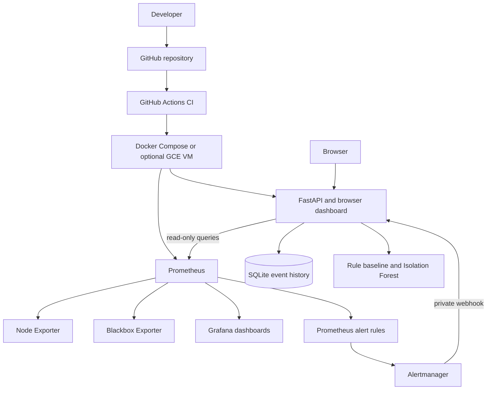

# Architecture and data flow

## Components

- **FastAPI** serves the browser dashboard, health and configuration APIs,
  monitoring queries, anomaly scoring and Prometheus counters for evaluations
  and findings, and a private Alertmanager receiver.
- **Prometheus** scrapes app metrics, Linux Node Exporter metrics, and
  Blackbox Exporter HTTP probes. It also scrapes Alertmanager and Blackbox
  Exporter health metrics. It retains up to seven days of samples.
- **Node Exporter** reads host metrics on supported Linux hosts. Docker Desktop
  on Windows exposes the Docker Linux environment, not a native Windows host
  exporter.
- **Blackbox Exporter** performs configured HTTP GET probes and reports
  availability, duration, and HTTP status metrics.
- **Grafana** loads a provisioned Prometheus datasource and infrastructure
  dashboard.
- **Alertmanager** groups Prometheus alerts and sends firing/resolved events to
  FastAPI over the private Compose network.
- **SQLite/SQLAlchemy** stores anomaly and alert event history in a persistent
  local volume.
- **Isolation Forest** scores validated metric samples against a reproducible
  demo model. Configurable threshold rules remain available as an independent
  baseline.

## Mermaid system diagram

## Monitoring flow

1. Prometheus scrapes configured targets every 15 seconds.
2. Node Exporter reports available Linux system counters and gauges.
3. Blackbox Exporter probes only the endpoints explicitly listed in
   `monitoring/prometheus/blackbox_targets.json`.
4. Prometheus evaluates configured alert expressions and their `for` durations.
5. Alertmanager forwards alert state changes to FastAPI. The application stores
   the latest state per alert fingerprint in SQLite.
6. FastAPI queries Prometheus for live and historical values. Missing or older
   than 120-second values are labelled stale rather than replaced with
   fabricated values.
7. An explicit scan reads a complete fresh metric sample, applies configured
   thresholds and (if trained) Isolation Forest, and persists anomaly events.

The target file is the operator-managed allowlist for Blackbox probes. The API
does not accept arbitrary probe URLs. Only add HTTP/HTTPS endpoints that the
operator owns or is authorized to monitor.

## Local ports and storage

| Service | Local address | Persistence |
|---|---|---|
| FastAPI/dashboard | `127.0.0.1:8000` | SQLite and model in `app-data` |
| Prometheus | `127.0.0.1:9090` | Seven-day TSDB in `prometheus-data` |
| Grafana | `127.0.0.1:3000` | Dashboards and settings in `grafana-data` |
| Alertmanager | `127.0.0.1:9093` | Alert state in `alertmanager-data` |
| Node Exporter | Internal only | None |
| Blackbox Exporter | Internal only | None |

Compose publishes management services only on loopback. A cloud VM deployment
should retain this property and use an HTTPS reverse proxy for the dashboard
only, with administrative monitoring access restricted separately.
