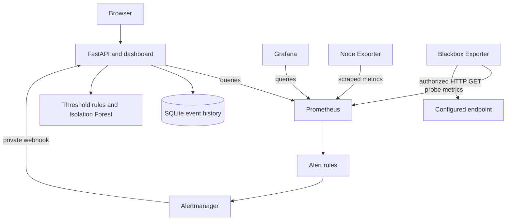
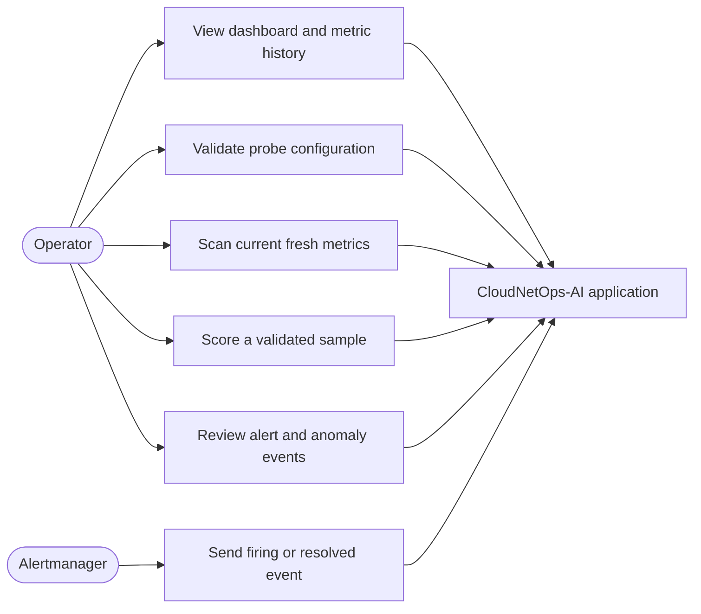
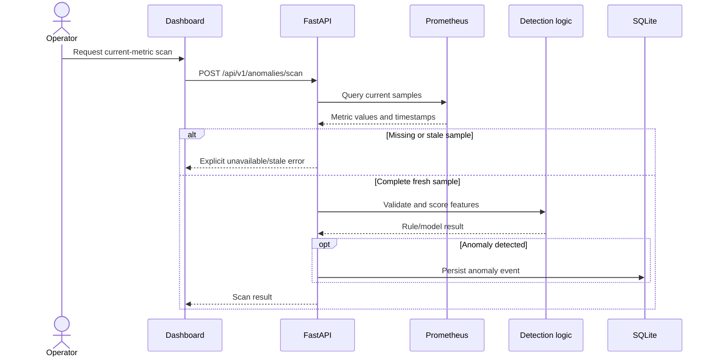
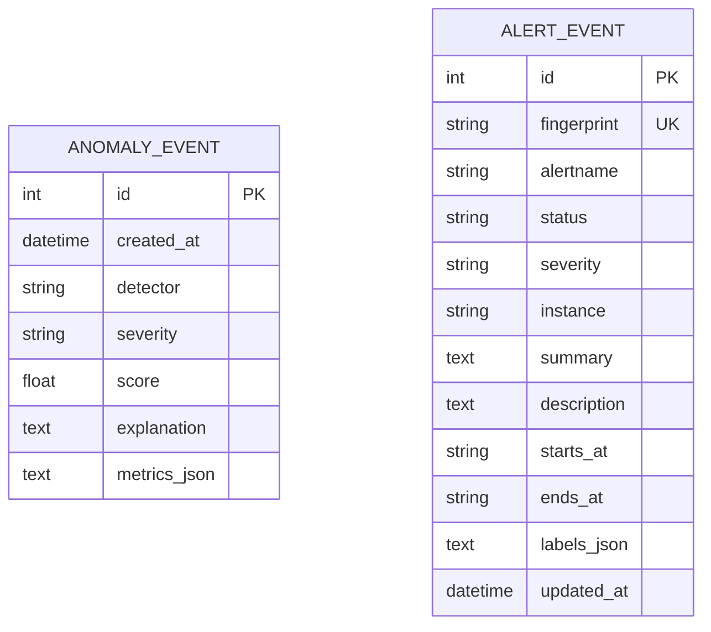

# CloudNetOps-AI

## Main project report draft

**Title:** CloudNetOps-AI: Local-First Infrastructure and Network Monitoring
with Anomaly Detection  
**Student name:** K R Bharath  
**USN:** 4UB25MC047  
**Programme / department:** MCA  
**Institution:** UBDT College of Engineering  
**Project guide:** Srinivasulu M  
**Academic year:** 2026-27

> This draft follows the 8-chapter sequence selected by the student from the
> supplied VTU-formatting notes. [Contents.pptx](../Contents.pptx) has a different 7-chapter
> sequence, so confirm which structure the department expects before
> submission. Neither item is a formatted Word report template. The literature
> entries below are provisional because only titles and short topic
> descriptions were supplied; the publications have not been verified.
> A separate formatting note supplied by the student recommends A4 paper,
> Times New Roman 12-point body text, 1.5 line spacing, 1.25-inch left margin,
> 1-inch right margin, 0.75-inch top/bottom margins, and numbered bracket
> citations. Verify these specifications against the current college/VTU
> circular before final print; this Markdown draft cannot enforce page layout.
> The VTU circular webpage [9] confirms the circular's title and date, but
> its linked PDF could not be reliably
> inspected here. Detailed font, cover-colour, plagiarism, penalty, page-limit,
> and portal-upload claims remain attributed to the supplied notes, not
> independently verified. Check the relevant circular pages before treating
> those details as official requirements.

## Certificate

[Insert the department-approved certificate page, names, signatures, dates,
and institutional wording.]

## Declaration

[Insert the student's original declaration using the college-approved
wording.]

## Acknowledgement

[Insert acknowledgements after confirming the names and roles of the guide,
department, institution, and any other contributors.]

## Abstract

CloudNetOps-AI is a local-first infrastructure and network monitoring
demonstration that combines a FastAPI application with Prometheus, Node
Exporter, Blackbox Exporter, Grafana, and Alertmanager. Prometheus collects
application, Linux-host, and explicitly configured HTTP/HTTPS endpoint
measurements. The application provides monitoring APIs and a browser
dashboard, and stores alert and anomaly events in SQLite. Configurable
threshold rules provide an interpretable baseline; a scikit-learn Isolation
Forest scores validated metric samples against a reproducible demonstration
model.

The implementation distinguishes missing or stale telemetry from current
measurements and does not create simulated live metrics. In the verified
environment, 18 unit and API tests passed, Ruff checks passed, the dependency
audit reported no known vulnerabilities, and the standalone application
container reached a healthy state. A separate generated synthetic test split
produced precision 0.8475, recall 1.0000, and F1 0.9174. These metrics describe
only the generated data and do not establish performance on production
infrastructure. The integrated monitoring stack could not be started because
Docker Hub image delivery failed during DNS resolution. No cloud resources
were created. The project is intended as a student-scale observability
demonstration and investigation aid, not as an autonomous remediation or
enterprise-availability system.

**Keywords:** infrastructure monitoring, Prometheus, observability, anomaly
detection, Isolation Forest, Docker Compose, alerting

## Table of contents

1. Introduction
2. Literature Review
3. System Requirement Analysis
4. System Design and Modeling
5. Implementation and Code Design
6. Testing Methodology
7. Results and Discussion
8. Conclusion and Future Enhancements
9. References
10. Appendices

Also include a list of figures, list of tables, and list of abbreviations
after applying the college's required front-matter format.

# Chapter 1 - Introduction

## 1.1 Background

Cloud and containerized applications depend on the health of hosts, services,
networks, and external endpoints. Operators therefore need more than a single
application health check: they need time-series measurements, service
availability checks, alert state, and a way to review unusual behaviour.
Prometheus and exporters provide metric collection, Grafana supports
visualization, and alert managers route state changes. A small project can
combine these building blocks to demonstrate an end-to-end monitoring
workflow without requiring a paid cloud account.

## 1.2 Existing situation

In a basic setup, host metrics, endpoint status, dashboards, and alerts may be
spread across separate tools. Threshold alerts can identify known conditions
but may not flag combinations of values that differ from a learned baseline.
Conversely, an anomaly score alone does not explain a root cause or confirm an
incident. This project combines conventional monitoring and threshold rules
with an experimental sample-level anomaly score, while keeping their roles
distinct.

## 1.3 Problem statement

The project addresses the lack of a reproducible student-scale environment
that brings together infrastructure and endpoint measurements, dashboards,
alert history, and exploratory anomaly scoring while clearly distinguishing
real telemetry from missing, stale, and synthetic data.

## 1.4 Need for the project

A local-first implementation gives students a way to study monitoring
components and their data flow with limited cost. Explicit validation,
timestamps, and stale-data handling also make the demonstration safer to
interpret than a dashboard that silently substitutes example values.

## 1.5 Objectives

- Collect available application and Linux host metrics with Prometheus.
- Probe only explicitly configured, authorized HTTP/HTTPS endpoints.
- Display current and historical measurements with units and timestamps.
- Evaluate Prometheus alert rules and retain alert state changes.
- Compare configurable threshold rules with Isolation Forest sample scoring.
- Validate inputs, detect stale or missing measurements, and report errors
  explicitly.
- Test the application and configuration through automated checks and CI.

## 1.6 Scope and exclusions

The project supports a local Docker Compose deployment and an optional,
manual-only GCP deployment guide. It does not automatically modify cloud
resources, perform network scanning, provide autonomous remediation, or
claim root-cause diagnosis. The default Node Exporter measurements represent
Linux; Docker Desktop on Windows does not expose native Windows host metrics
through this configuration. The Isolation Forest training and evaluation
data are synthetic.

## 1.7 Methodology and expected benefits

The implementation is divided into monitoring, application/API, event
storage, anomaly scoring, visualization, and CI components. The expected
benefit is a small, reproducible example of how these pieces can be connected
and tested. The project reports verified behaviour and limitations rather
than assuming that configured services have been successfully integrated.

# Chapter 2 - Literature Review

## 2.1 Review status

The following titles and focus descriptions were provided by the student.
They are recorded here as literature-review candidates, not as verified
publications. Author names, publication years, venue, DOI or arXiv identifier,
full text, and working source URLs were not included. The phrases below
summarize only the supplied descriptions; they are not independently
confirmed findings. Do not submit this section as a completed literature
review until the sources and bibliographic records have been checked.

| No. | Student-supplied title | Student-supplied focus |
|---|---|---|
| 1 | AI in Cloud Computing: Enhancing Services and Performance | AI-driven cloud operations, intelligent monitoring, self-healing systems, and container orchestration. |
| 2 | AI in Cloud-Native Architecture: Rethinking Software Design for Data-Intensive and Machine Learning Systems | Cloud-native orchestration, resource allocation, and infrastructure lifecycle automation. |
| 3 | Digital Transformation: The Impact of AI on Cloud Transformation | AI-based infrastructure management, operational efficiency, and cloud-service security. |
| 4 | Artificial Intelligence for Real-Time Cloud Monitoring and Troubleshooting | Real-time anomaly detection and automated incident remediation. |
| 5 | LLM Assisted Anomaly Detection Service for Site Reliability Engineers: Enhancing Cloud Infrastructure Resilience | LLM-assisted SRE workflows and infrastructure fault isolation. |
| 6 | CloudAnoAgent: Anomaly Detection for Cloud Sites via LLM Agent | An agentic approach to investigate and report telemetry anomalies. |
| 7 | Anomaly Detection in Large-Scale Cloud Systems: An Industry Case and Dataset | Industrial telemetry datasets and production monitoring practices. |
| 8 | Praxium: Diagnosing Cloud Anomalies with AI-Based Telemetry and Installation Logs | Combining installation/build logs and runtime metrics to investigate configuration drift and pipeline bottlenecks. |

## 2.2 Comparison framework

After obtaining the full papers, review each source using the same fields:
problem addressed, dataset or test environment, method, evaluation measures,
reported findings, limitations, and relevance to CloudNetOps-AI. A comparison
of numerical performance is not appropriate unless the papers use
comparable datasets and protocols. No such comparisons are asserted in this
draft.

## 2.3 Relationship to this project

Based on the supplied topic descriptions alone, the candidates concern cloud
monitoring, anomaly detection, automation, and operational diagnosis.
CloudNetOps-AI is narrower: it is a local-first monitoring demonstration
using Prometheus-based collection, explicit threshold rules, and a synthetic
Isolation Forest demonstration. It does not implement self-healing,
LLM-based diagnosis, or automated remediation. Any stronger comparison must
wait until the full sources have been reviewed.

# Chapter 3 - System Requirement Analysis

## 3.1 Existing and proposed systems

An operator can assemble separate monitoring tools for metric collection,
visualization, and alerting. Such a setup may require manual correlation of
host measurements, endpoint checks, and alert history. A threshold-only
approach is straightforward to explain but only detects conditions encoded
in the configured rules.

CloudNetOps-AI proposes a local Compose environment that connects these
monitoring elements to a FastAPI application and event store. It adds
sample-level anomaly scoring as an exploratory signal without claiming
automated diagnosis or remediation.

## 3.2 Feasibility study

- **Technical:** The project uses established open-source components and
  Docker Compose. The application and its standalone container were tested;
  integrated monitoring services remain unverified because their images
  could not be downloaded in this environment.
- **Economic:** The local workflow uses no paid services or cloud resources.
  It requires local memory and disk for the containers, images, and stored
  monitoring data.
- **Operational:** The system is intended for a student demonstration.
  Monitoring ports are local, the application has no built-in user login,
  and the Alertmanager webhook is intended for the private Compose network.

## 3.3 Software requirements specification

### Functional requirements

1. Expose a liveness endpoint and configuration validation API.
2. Query current and historical Prometheus measurements.
3. Indicate absent or stale measurements instead of fabricating values.
4. Score validated metric samples using threshold rules and the trained
   demonstration model.
5. Accept Alertmanager state changes through a private network webhook.
6. Retain alert and anomaly events in local SQLite storage.

### Non-functional requirements

- Run locally with Docker Compose and documented Python development tooling.
- Keep monitoring service ports on loopback for the local deployment.
- Reject invalid input and return explicit errors for unavailable monitoring
  data.
- Make synthetic model training and evaluation deterministic and
  reproducible.

## 3.4 Hardware and software requirements

The documented local setup uses Windows with Docker Desktop or Ubuntu/Linux
with Docker Engine and Docker Compose, with approximately 2 GB of available
memory suggested for the stack. Python 3.12 is the documented development
baseline. The verification environment used Python 3.15.2 and Docker Engine
29.9.2 with Compose 5.6.1; these environment values do not imply that every
integrated service ran successfully.

# Chapter 4 - System Design and Modeling

## 4.1 System architecture

Prometheus scrapes application, Linux host, and Blackbox Exporter targets.
Grafana queries Prometheus for dashboards. Prometheus evaluates alert rules
and routes state changes to Alertmanager, which sends them to the private
FastAPI webhook. FastAPI also queries Prometheus and stores events in SQLite.

## 4.2 Use-case model

## 4.3 Module and component descriptions

| Module | Responsibility |
|---|---|
| Metrics collection | Prometheus scrapes application, Linux host, and configured endpoint measurements. |
| Dashboard and API | FastAPI serves the dashboard, health/configuration endpoints, monitoring queries, and anomaly APIs. |
| Visualization | Grafana provides provisioned infrastructure panels using Prometheus data. |
| Alert processing | Prometheus rules feed Alertmanager, which sends state changes to the private webhook. |
| Event storage | SQLAlchemy and SQLite retain alert and anomaly event history. |
| Anomaly scoring | Threshold rules and Isolation Forest score validated samples. |
| CI | GitHub Actions runs lint, dependency audit, tests, configuration validation, and image build. |

## 4.4 Data flow and sequence

1. Prometheus scrapes configured targets every 15 seconds.
2. The dashboard/API requests live or historical values from Prometheus.
3. Values older than 120 seconds or absent samples are represented as stale
   or unavailable.
4. An explicit scan uses a complete, fresh metric sample; missing or stale
   fields cause an explicit error instead of a fabricated score.
5. Alertmanager sends firing and resolved notifications to the private API
   receiver, which stores the alert state in SQLite.

## 4.5 Data model and security boundaries

The application uses SQLite tables for alert and anomaly event history.
Alert state is associated with an alert fingerprint so subsequent firing or
resolved notifications update the same logical alert record. The local
database is suitable for the demonstration and is not presented as a
high-throughput production store.

The two event types are stored independently; no foreign-key relationship is
defined between them.

Local service ports bind to loopback; exporters remain internal to the Compose
network. The Alertmanager webhook is intended for that private network and
must not be exposed through a public reverse proxy. The application does not
provide user authentication, so any cloud deployment needs a separately
configured access-control layer. Endpoint probes must be limited to systems
the operator is authorized to monitor.

# Chapter 5 - Implementation and Code Design

## 5.1 Technology

The system uses FastAPI and Pydantic for the application API, Prometheus and
exporters for metrics, Grafana for visualization, Alertmanager for alert
routing, SQLAlchemy/SQLite for event history, and NumPy, pandas, and
scikit-learn for model training and evaluation. Docker Compose describes the
local services and their network and storage relationships.

## 5.2 Monitoring and API implementation

Prometheus queries provide current summaries and time-series history. The
application preserves measurement units and timestamps and reports stale or
missing data explicitly. Configuration validation checks the Blackbox target
file. The anomaly endpoints validate caller-provided samples; the current
metric scan requires a complete and fresh Prometheus sample.

## 5.3 Anomaly detection

Threshold rules use configurable CPU, memory, and disk limits as a transparent
baseline. The Isolation Forest consumes a validated feature row and returns a
sample-level anomaly score. It does not provide per-feature attribution.
The demonstration model is trained from deterministic synthetic data; the
evaluation set is a separate generated split. These samples are not a
substitute for labelled data from a real environment.

## 5.4 Database and event handling

SQLAlchemy persists alert and anomaly events in SQLite. Alertmanager
notifications update state by alert fingerprint. SQLite is chosen for
local simplicity and is not presented as a high-volume production database.

## 5.5 CI and deployment

GitHub Actions runs Ruff, the dependency audit, unit/API tests, Compose
validation, Prometheus configuration validation, JSON parsing, and an
application image build. An optional manual GCP workflow is documented, but
requires explicit identity configuration and an existing VM. It was not run
for this project verification and no cloud resources were created.

# Chapter 6 - Testing Methodology

## 6.1 Testing strategy

The test strategy combines unit tests for anomaly and configuration logic,
in-process API tests for health, validation, and event persistence, and
separate environment checks for lint, dependencies, Compose, JavaScript, and
container health. The integrated Compose services, scrape targets, approved
HTTP probe, and firing alert path were also checked in the local environment.

## 6.2 Test case matrix

| ID | Test | Expected outcome | Actual status |
|---|---|---|---|
| T-01 | API health and OpenAPI | Health response and documented route | Pass: 26 tests |
| T-02 | Input validation | Invalid CPU value returns HTTP 422 | Pass |
| T-03 | Rule detection and event persistence | Live metric finding and event ID returned | Pass |
| T-04 | Synthetic model evaluation | Metrics calculated on a generated test split | Pass |
| T-05 | Compose configuration | Compose model validates | Pass |
| T-06 | Prometheus and Alertmanager rules | `promtool` and `amtool` accept configurations | Pass: seven Prometheus rules |
| T-07 | Application container build | Updated application image builds | Pass |
| T-08 | Integrated stack health | Services start and targets become healthy | Pass: six services running; six scrape targets up |
| T-09 | Endpoint probe | Authorized target status visible in Prometheus | Pass: `https://example.com` probe returned 1 |
| T-10 | Alert flow | Firing event reaches Alertmanager and API history | Pass for firing; recovery not tested |
| T-11 | Static and dependency checks | Ruff clean and no known vulnerable dependencies | Pass |

These are the recorded checks in the current development environment. The
test procedures and limitations are documented in [testing.md](./testing.md).

# Chapter 7 - Results and Discussion

## 7.1 Experimental setup

The local checks ran on Windows using Python 3.15.2, pytest 9.1.1, Docker
Engine 29.9.2, and Compose 5.6.1. The application container runs Python
3.12.16, and the CI workflow targets Python 3.12. A Starlette/httpx
TestClient deprecation warning was reported during tests.

## 7.2 Application and validation results

The unit and API suite passed all 26 tests. Ruff reported no findings, the
dependency audit found no known vulnerabilities in the runtime and
development requirements, Compose configuration validated, and the dashboard
JavaScript passed syntax checking. The updated application image built, and
all six Compose services started. The app and Prometheus containers reported
healthy; all six configured Prometheus targets were up. The
`https://example.com` probe succeeded, Grafana provisioned its nine-panel
dashboard, and a live threshold finding reached the Alertmanager/API history
path.

## 7.3 Synthetic model evaluation

The deterministic evaluation used 500 generated test rows. The confusion
matrix, with actual classes as rows and predicted classes as columns
(normal = 0, unusual = 1), was `[[382, 18], [0, 100]]`.

| Measure | Result |
|---|---:|
| Precision | 0.8475 |
| Recall | 1.0000 |
| F1 score | 0.9174 |

These are measurements on generated samples only. They are not estimates of
production accuracy, detection rate, or operational value.

## 7.4 Discussion and limitations

The API, data validation, event persistence, deterministic model workflow,
and integrated local Prometheus/exporter/Grafana/Alertmanager stack were
verified. A live alert reached the private receiver; alert recovery was not
tested. This supports a local demonstration claim, not production
availability. No throughput, resource overhead, or live model-quality
benchmark is available.

# Chapter 8 - Conclusion and Future Enhancements

## 8.1 Conclusion

CloudNetOps-AI implements a local-first monitoring demonstration that joins
metrics collection, dashboards, alert routing, event history, and
experimental anomaly scoring. Its verified application checks pass, and its
data-handling behaviour avoids presenting stale or missing samples as current
telemetry. The generated model evaluation is reproducible but synthetic.
Optional cloud deployment remains unverified and was not performed.

## 8.2 Achievements

- Implemented the FastAPI monitoring APIs and browser dashboard.
- Configured Prometheus, Grafana, Alertmanager, Node Exporter, and Blackbox
  Exporter for local Compose use.
- Added alert and anomaly event persistence.
- Implemented threshold rules and a synthetic Isolation Forest training and
  evaluation path.
- Added automated tests, CI checks, security documentation, and optional
  manual cloud guidance.

## 8.3 Future enhancements

- Run the complete stack on a Linux host with successful image pulls and
  record target health and genuine screenshots.
- Obtain consented, representative, labelled historical metrics and evaluate
  the model with a documented protocol.
- Complete the literature review using verified full texts and bibliographic
  details.
- Add authenticated access and operational backups before any externally
  accessible deployment.
- Evaluate additional storage and scaling approaches only if the project
  requirements justify them.

# References

The following are provisional title records supplied by the student. The
author, year, publisher/venue, DOI or repository identifier, and source URL
must be completed from each original publication before these entries are
formatted for VTU Belagavi submission. Crossref lookup could not be completed
in the current environment because external DNS resolution failed. No
authors, dates, findings, or links have been inferred for these papers.

1. *AI in Cloud Computing: Enhancing Services and Performance.* Bibliographic
   details and source URL not provided.
2. *AI in Cloud-Native Architecture: Rethinking Software Design for
   Data-Intensive and Machine Learning Systems.* Bibliographic details and
   source URL not provided.
3. *Digital Transformation: The Impact of AI on Cloud Transformation.*
   Bibliographic details and source URL not provided.
4. *Artificial Intelligence for Real-Time Cloud Monitoring and
   Troubleshooting.* Bibliographic details and source URL not provided.
5. *LLM Assisted Anomaly Detection Service for Site Reliability Engineers:
   Enhancing Cloud Infrastructure Resilience.* Bibliographic details and
   source URL not provided.
6. *CloudAnoAgent: Anomaly Detection for Cloud Sites via LLM Agent.*
   Bibliographic details and source URL not provided.
7. *Anomaly Detection in Large-Scale Cloud Systems: An Industry Case and
   Dataset.* Bibliographic details and source URL not provided.
8. *Praxium: Diagnosing Cloud Anomalies with AI-Based Telemetry and
   Installation Logs.* Bibliographic details and source URL not provided.
9. Visvesvaraya Technological University, “Circular – Online submission of
   MCA Final Semester project reports – reg,” 23 Aug. 2025. [Online].
   Available: <https://vtu.ac.in/en/2025/08/37637/>. Accessed: 27 Oct. 2026.

# Appendices

- **Appendix A - Source code:** Refer to the project repository and
  [README](../README.md) for the application, monitoring configuration, and
  run commands.
- **Appendix B - Test record:** Refer to [testing results](./testing.md) for
  the commands, outcomes, and environment limitations.
- **Appendix C - Operations:** Refer to the [setup guide](./setup.md),
  [security notes](./security.md), and [demonstration script](./demo_script.md).
- **Appendix D - Figures and screenshots:** Insert screenshots only after
  the integrated application is running successfully; label the host,
  timestamp, and source of each displayed measurement.
